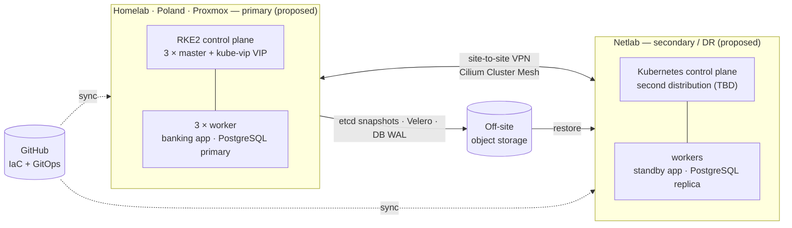

# Secure Multi-Site Kubernetes for a Banking Workload

Semester 7 personal project. This repo holds the Infrastructure as Code and GitOps manifests for two Kubernetes clusters on two sites, hardened with zero-trust principles, with automated disaster recovery between them.

> **Status:** Phase 1 — building the Homelab cluster (RKE2, 3 masters + 3 workers). See the [roadmap](#roadmap).

## Research question

> How can we architect a secure enterprise infrastructure with Kubernetes for a banking system that provides an automated disaster recovery system?

1. What is the current optimal way to architect and create enterprise-level clusters?
2. What security considerations matter while setting up and maintaining Kubernetes clusters?
3. How can network and application-level policies prevent unauthorised lateral movement between workloads?
4. How can disaster recovery be automated so there is almost no downtime when the main cluster goes down?

Full plan: [docs/Project Plan_v1.pdf](docs/Project%20Plan_v1.pdf)

## Target architecture



| | Homelab | Netlab |
|---|---|---|
| Location | Poland | Netlab |
| Hypervisor | Proxmox VE | TBD |
| Kubernetes | RKE2 v1.36 — 3 masters, 3 workers | TBD — [options](docs/ideas.md#1-second-cluster-a-different-enterprise-approach) |
| Role | primary (proposed) | secondary / DR (proposed) |

## Stack

| Layer | Choice | Status |
|---|---|---|
| Node OS | Ubuntu 26.04 LTS | decided |
| Kubernetes (Homelab) | RKE2 v1.36.5, CIS profile | decided |
| CNI | Cilium with kube-proxy replacement + Hubble | in config, to review |
| API high availability | kube-vip (ARP) | in config, to review |
| Ingress | Traefik (RKE2 default) | in config, to review |
| VPN, mTLS, secrets, GitOps, DR, storage, observability | — | open — see [docs/ideas.md](docs/ideas.md) |

## Repository layout

```
.
├── rke2-config/      Homelab RKE2 cluster: node configs, bootstrap manifests, node prep script
├── docs/             project plan, network plan, ideas & roadmap, Claude Code guide
├── ansible/          (planned) node preparation and RKE2 install as code
├── terraform/        (planned) Proxmox VMs with OpenTofu
├── clusters/         (planned) GitOps entry point per cluster
├── platform/         (planned) shared platform services: policies, observability, secrets
└── apps/             (planned) the dummy banking application
```

## Getting started

1. Read [docs/network-plan.md](docs/network-plan.md) and replace the example IPs and hostnames.
2. Follow [rke2-config/README.md](rke2-config/README.md) to build the Homelab cluster.

## Roadmap

Phases follow the timeline in the project plan.

- **Weeks 1–7 — Research and design**
  - [x] Project plan
  - [ ] Product analysis: second-site distribution, VPN, mTLS, secrets, DR tooling
  - [ ] Architecture diagrams and network plan
  - [ ] Decisions recorded as ADRs
- **Weeks 4–9 — Two working clusters**
  - [ ] Homelab RKE2 cluster (3 + 3) — *in progress*
  - [ ] Baseline CIS scan (kube-bench)
  - [ ] Netlab cluster
  - [ ] Site-to-site VPN + Cilium Cluster Mesh
  - [ ] GitOps bootstrap on both clusters
  - [ ] VMs and node setup as code (OpenTofu + Ansible)
- **Weeks 10–12 — Hardening and test application**
  - [ ] Default-deny network policies, mTLS, admission policies, runtime detection
  - [ ] Centralised secrets management
  - [ ] Banking test application deployed
- **Weeks 13–15 — Disaster recovery and backups**
  - [ ] RTO / RPO defined
  - [ ] etcd + Velero + database backups off-site
  - [ ] Database replication to the secondary site
  - [ ] Automated failover
- **Weeks 16–17 — Security and resilience testing**
  - [ ] Lateral movement simulation (before vs. after hardening)
  - [ ] Primary site failure, RTO / RPO measured
  - [ ] Latency overhead measured
- **Weeks 18–20 — Evaluation and documentation**
  - [ ] Research report, technical report, final presentation and live demo

## Methodology

The research follows the DOT framework:

| Method | Used for | Output |
|---|---|---|
| Available product analysis (Library) | choosing the stack | `docs/research/`, ADRs |
| IT architecture sketching (Workshop) | designing both clusters, connectivity, security, DR | diagrams, `docs/network-plan.md`, ADRs |
| System and security test (Lab) | functional, attack and failover tests | test reports, measurements |
| Peer review (Showroom) | feedback from coaches and peers | final report |

## Secrets

Nothing secret is ever committed. RKE2 join tokens are plain files on the nodes (`token-file`), kubeconfigs stay in `~/.kube`, and [.gitignore](.gitignore) blocks the usual suspects. Encrypted secrets (SOPS) and a secrets manager come in the hardening phase.

## Working with Claude Code

This repo is set up for [Claude Code](https://claude.com/claude-code): [CLAUDE.md](CLAUDE.md) carries the project context and [.claude/](.claude/) holds permissions, agents and skills. See [docs/claude-code-guide.md](docs/claude-code-guide.md).
